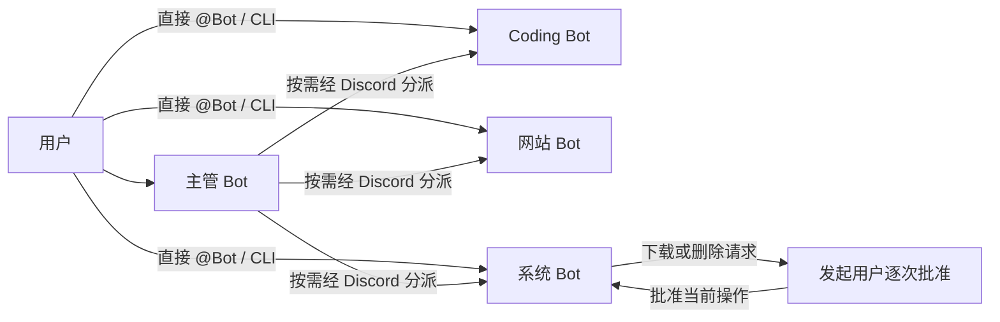

# 云端功能 Bot 与双入口调度

默认只使用云端模型。首版在一个进程中托管多个功能角色，每个角色绑定独立 Discord Bot。模型之间的任务和结果经过 Discord 发布、读取和身份校验；后续可以拆成独立 worker。



## 功能角色

| 功能 | 默认模型 | 工具 | Bot 凭据变量 |
|---|---|---|---|
| 主管 `coordinator` | DeepSeek `deepseek-flash`，开启思考、力度 `high`，模型键 `primary` | 按需调度、汇总或直接回答 | `DISCORD_COORDINATOR_BOT_TOKEN` |
| 编码 `coding` | `gpt-6.1-sol` | 生成、解释和检查代码、提出测试建议 | `DISCORD_CODING_BOT_TOKEN` |
| 网站 `web` | 暂用 OpenAI `gpt-6-astra`，未定案 | OpenAI 联网搜索、读取公开 HTML/文本、提供来源链接 | `DISCORD_WEB_BOT_TOKEN` |
| 系统 `system` | 暂用 OpenAI `gpt-6-sol`，未定案 | CPU/内存状态、目录列表、文件读取、经批准下载和删除 | `DISCORD_SYSTEM_BOT_TOKEN` |

功能 Bot 地位平等，不再固定执行“研究、编码、审查”流水线。主管可只调用一个功能，也可直接回答；编码 Bot 自行检查方案，首版没有单独审查角色。编码仍使用你选的 GPT6.1，目前生成代码，尚不执行代码或写入源文件。

主管按你提供的示例，使用 OpenAI SDK 的异步 Chat Completions 接口访问 DeepSeek：

```yaml
primary:
  provider: deepseek
  model: deepseek-flash
  base_url: https://api.deepseek.com
  api_key_env: DEEPSEEK_API_KEY
  thinking: enabled
  reasoning_effort: high
```

`thinking: enabled` 对应 SDK 的 `extra_body={"thinking":{"type":"enabled"}}`，`reasoning_effort: high` 原样发送。SDK 是客户端，主管请求的服务仍是 DeepSeek；不会发送到 OpenAI。关闭思考可设为 `disabled` 并移除推理力度字段。客户端缓存区分思考模式和力度，SDK 自动重试关闭，避免未知失败时重复推理。

编码保持 OpenAI GPT6.1。系统和网站的服务与型号尚未选择，表中的 OpenAI 配置是临时占位。OpenAI 型号列于官方 SDK，所有型号的实际账户访问、额度及联网工具支持仍需真实验证。

主管使用独立的 `DEEPSEEK_API_KEY`（发送到 `api.deepseek.com`）；OpenAI 角色使用 `CODING_API_KEY`（发送到 `api.openai.com`）。两家服务的 Key 不混用，Bot Token 均只从环境设置读取。DeepSeek 使用 JSON 输出模式，调度决定的字段、目标角色和预算由程序验证；不把返回 JSON 等同于合法调度授权。无效决定会停止任务。

主管采用你选择的 Flash 思考模式；如果等待时间成为问题，再调整思考力度或模式。系统功能建议优先试较轻的通用模型（例如 `gpt-6-luna`），授权规则由工具后端控制；网站优先选择支持原生 `web_search` 的模型。系统和网站暂不切换，待确认型号及工具支持后再改配置。DeepSeek 适配支持 function 工具，不能直接使用 OpenAI 原生 `web_search`；换成 DeepSeek 网站角色时应取消该原生工具并使用独立搜索工具。

## 调度入口

在虚拟环境中安装依赖并设置 `PYTHONPATH=src` 后，可直接使用命令行，不需要 Discord Token：

```bash
python -m companion --agent coding "写一个配置加载器"
python -m companion --agent system "查看 CPU 和内存状态"
python -m companion
```

交互入口支持 `/chat`、`/coding`、`/web`、`/system`、`/role NAME`、`/exit`。各角色分别保存已成功完成的会话历史；失败不写入会话。这个入口直接调用所选功能，主管调度入口为下列 Discord 工作流命令。

通过 Discord 通道一次性运行任务：

```bash
# 主管决定调用哪些功能 Bot
python -m companion.discord_workflow "查资料并设计配置加载器"
# 直接调用编码 Bot，不调用主管模型，只需该 Bot 的 Token
python -m companion.discord_workflow --agent coding "写一个配置加载器"
```

开启 Discord @Bot 入口：

```bash
python -m companion.discord_listener
```

启动后，在配置频道发送 `@coding 任务`、`@web 任务`、`@system 任务` 可直接调度；发送 `@主管 任务` 由主管按需分派。`coding` 等指该角色实际 Bot 的 Discord 提及，不是普通文字标签。只有 `DISCORD_OPERATOR_IDS` 中登记的人类账号可发起任务。

这些 Discord 命令会主动向频道发布任务与结果。不会开机自动运行；`--help` 不发送消息。所有任务与文件结果都可能出现在该频道，请使用专用频道。

## Discord 和环境配置

1. 创建四个独立 Discord 应用及 Bot，加入同一专用服务器频道。不能复用 Bot 身份。
2. 给 Bot 配置 View Channel、Read Message History、Send Messages、Attach Files。
3. 为读取通道的 Bot 开启 **Message Content Intent**。监听器和主管调度使用主管读取；直接工作流使用目标 Bot 读取，因此推荐四个 Bot 都开启。启动会检查 `/applications/@me` flags；REST 读取同样受限制。
4. 在环境设置填写 `DEEPSEEK_API_KEY`、`CODING_API_KEY` 和上述四个 Bot Token。设置 `DISCORD_CHANNEL_ID`，以及监听器使用的 `DISCORD_OPERATOR_IDS`（你的 Discord 用户 ID；多个 ID 用英文逗号分隔）。ID 不是凭据，不能用显示名称代替。
5. 设置 `SYSTEM_WORKSPACE` 为专用目录；未设置时使用当前目录下的 `.spirit-workspace`。云环境建议 `/workspace/spirit-runtime/system`。在云端运行时操作的是云端机器，访问你自己的电脑需在那台电脑运行程序。
6. 云环境配置需由环境设置界面保存并发布，保存草稿本身不会注入值。旧 `DISCORD_REVIEW_BOT_TOKEN`、`DISCORD_RESEARCH_BOT_TOKEN` 已不被当前代码使用，可在设置界面移除旧要求。

使用 Discord REST 轮询，不需要 Gateway WebSocket。网络允许 `api.deepseek.com`、`api.openai.com`、`discord.com`、`cdn.discordapp.com`。网页读取和文件下载的允许主机由 `agents.yaml` 的 `web_domains` 指定，同时需允许云环境访问相应域名。OpenAI 原生搜索由服务端访问网络，不受客户端网页读取域名表约束。单独直接调用 OpenAI Coding 时无需 DeepSeek Key；主管调度和完整监听器需要两家凭据。

## 下载和删除权限

状态查询、列目录、读取文件不弹出批准。下载和删除每次都由工具后端请求授权，展示请求 ID、发起人、任务、具体 URL 或路径、大小/上限和可选校验值。主管、模型、其他 Bot 和其他操作员都不能代替发起用户批准。

Discord 批准必须明确回复，例如：

```text
@system approve 具体请求ID
@system deny 具体请求ID
```

批准消息由监听器直接处理，不交给模型判断。授权仅用于这一个请求；过期、已使用、其他用户的批准不会执行操作。等待批准时监听器仍继续接收 Discord 消息；超时或停止任务会取消待批请求。同一任务对相同操作的拒绝不会反复弹出。命令行发起的操作在终端显示详情并输入 `y`，不在 Discord 批准；非交互终端默认拒绝。批准窗口默认 300 秒，授权工具总预算 360 秒，整个任务默认 600 秒。

文件操作仅在 `SYSTEM_WORKSPACE` 内使用相对路径，拒绝越界、绝对路径、符号链接、环境凭据文件和内部控制目录。默认限制是应用层路径检查，不能隔离同机其他进程，建议使用专用目录并避免其他程序同时修改它。

下载仅接受配置域名的 HTTPS：批准前仅发 HEAD 请求查询元信息；对每次重定向检查域名，并展示最终 URL。批准后才 GET 内容，最大 10 MiB，写入新文件，不覆盖已有目标；可验证用户给定的 SHA-256。批准后 URL 发生重定向会停止操作，不自动换下载目标。

删除仅支持单个文件，移到 `.agent-internal/trash/恢复ID`，不递归删除目录或永久擦除。批准前后校验文件是否改变。返回的恢复 ID 与 `.agent-internal/audit.jsonl` 可用于手工恢复；模型不能访问内部回收和审计目录。审计记录申请、批准/拒绝、完成或失败。

已完成的文件操作不会因后续模型失败自动撤销。请以审计日志和文件状态判断是否完成，不把最终回答当作唯一依据。

## 扩展与边界

新增功能 Bot 时，在 `models.yaml` 添加模型，在 `agents.yaml` 的 `agents` 添加 `model_role`、`token_env`、`description`、`prompt`，并登记独立 Token。无需把它插入固定流程，主管会从角色目录发现它，用户也能直接 @ 或 `--agent 新角色` 调度。已有工具通过 `tools` 分配给该角色；全新操作需实现和注册工具。配置最多 32 个角色；旧 `workflow` 字段仅用于兼容早期显式流程，默认不设置。

每个角色独立注册工具。系统工具不向编码、网站或主管开放；批准接口不作为模型工具。网页、文件和其他 Bot 输出作为参考数据处理。

监听器最多同时处理三个用户任务；一个任务内主管串行分派，最多六次，超预算停止。消息包含 job/task ID、角色、步数、有效期，过滤未知 Bot、伪造发送角色、无关任务、过期或重复投递。每次调用仍有三轮、八次本地工具调用和 120 秒模型等待限制，原生搜索每次 API 请求最多八次。

协议包最多 512 KiB、任务和结果最多 32000 字符，上下文最多 64000 字符。长任务以 JSON 附件发送；长最终回答以文本附件发送。Bot 授权头不会发给 Discord CDN 或网站。429 限流等待有上限；未知发送失败不自动重试。内部 reasoning 不发到 Discord。

任务状态只在内存中；启动跳过旧频道消息，重启不恢复中断任务。首版不支持网页登录、JavaScript 浏览器、任意 shell、代码执行、源文件写入、持久化任务恢复或独立 worker 部署。

自动验证使用模拟 Discord/DeepSeek/OpenAI HTTP 服务和临时目录，覆盖跨服务主管调度、两种入口、真实 Gateway/Agent 代码路径、联网工具、批准等待、身份拒绝、一次性授权、文件操作、长附件及限流。真实推理、搜索和 Discord 投递需有效凭据与账户权限；离线通过不等于已完成真实联调。DeepSeek 官方 API 文档和 API 在本次开发时尚受环境网络规则限制，适配行为仅通过模拟 API 验证。

参考：[Discord 消息 API](https://docs.discord.com/developers/resources/message)、[限流](https://docs.discord.com/developers/topics/rate-limits)、[Message Content Intent](https://docs.discord.com/developers/events/gateway#message-content-intent)、[OpenAI 模型 ID](https://github.com/openai/openai-python/blob/main/src/openai/types/shared/chat_model.py)。
