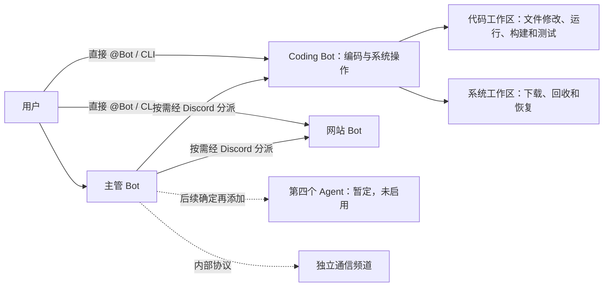

# 云端功能 Bot 与双入口调度

默认只使用云端模型。首版在一个进程中托管多个功能角色，每个角色绑定独立 Discord Bot。模型之间的任务和结果经过 Discord 发布、读取和身份校验；后续可以拆成独立 worker。



## 功能角色

| 功能 | 默认模型 | 工具 | Bot 凭据变量 |
|---|---|---|---|
| 主管 `coordinator` | DeepSeek `deepseek-flash`，开启思考、力度 `high`，模型键 `primary` | 按需调度、汇总或直接回答 | `DISCORD_COORDINATOR_BOT_TOKEN` |
| 编码与系统 `coding` | `gpt-6.1-sol` | 项目读写、运行/编译/测试、CPU/内存状态、目录与文件、下载、删除和恢复 | `DISCORD_CODING_BOT_TOKEN` |
| 网站 `web` | 暂用 OpenAI `gpt-6-astra`，未定案 | OpenAI 联网搜索、读取公开 HTML/文本、提供来源链接 | `DISCORD_WEB_BOT_TOKEN` |
| 第四个 Agent | 待定，未启用 | 功能待定，确定后注册 | 暂不要求 |

功能 Bot 地位平等，不再固定执行“研究、编码、审查”流水线。主管可只调用一个功能，也可直接回答；编码 Bot 自行检查方案。系统角色已并入 Coding，主管把代码任务和系统任务都分派给 `coding`。目前只注册三个角色，第四个不进入调度目录，不要求额外 Token。编码仍使用你选的 GPT6.1，具备项目文件操作和通用项目命令工具，不按编程语言注册单独接口。

主管按你提供的示例，使用 OpenAI SDK 的异步 Chat Completions 接口访问 DeepSeek：

```yaml
primary:
  provider: deepseek
  model: deepseek-flash
  base_url: https://api.deepseek.com
  api_key_env: DEEPSEEK_API_KEY
  thinking: enabled
  reasoning_effort: high
```

`thinking: enabled` 对应 SDK 的 `extra_body={"thinking":{"type":"enabled"}}`，`reasoning_effort: high` 原样发送。SDK 是客户端，主管请求的服务仍是 DeepSeek；不会发送到 OpenAI。关闭思考可设为 `disabled` 并移除推理力度字段。客户端缓存区分思考模式和力度，SDK 自动重试关闭，避免未知失败时重复推理。

编码与系统操作共用 OpenAI GPT6.1；旧 `system` 模型占位已移除。网站的服务与型号尚未选择，表中的 OpenAI 配置是临时占位。OpenAI 型号列于官方 SDK，用户已报告主管在本地 Discord 运行成功，其他型号的实际账户访问、额度及联网工具支持仍需真实验证。

主管使用独立的 `DEEPSEEK_API_KEY`（发送到 `api.deepseek.com`）；OpenAI 角色使用 `CODING_API_KEY`（发送到 `api.openai.com`）。两家服务的 Key 不混用，Bot Token 均只从环境设置读取。DeepSeek 使用 JSON 输出模式，调度决定的字段、目标角色和预算由程序验证；不把返回 JSON 等同于合法调度授权。无效决定会停止任务。

主管采用你选择的 Flash 思考模式；如果等待时间成为问题，再调整思考力度或模式。网站优先选择支持原生 `web_search` 的模型。网站暂不切换，待确认型号及工具支持后再改配置。DeepSeek 适配支持 function 工具，不能直接使用 OpenAI 原生 `web_search`；换成 DeepSeek 网站角色时应取消该原生工具并使用独立搜索工具。

## 调度入口

在虚拟环境中安装依赖并设置 `PYTHONPATH=src` 后，可直接使用命令行，不需要 Discord Token：

```bash
python -m companion --agent coding "写一个配置加载器"
python -m companion --agent coding "查看 CPU 和内存状态"
python -m companion
```

交互入口支持 `/chat`、`/coding`、`/web`、`/role NAME`、`/exit`。旧 `/system`、`/role system`、`--agent system` 转到 Coding；自定义配置若明确注册独立 `system` 则以配置为准。各角色分别保存已成功完成的会话历史；失败不写入会话。这个入口直接调用所选功能，主管调度入口为下列 Discord 工作流命令。

通过 Discord 通道一次性运行任务：

```bash
# 主管决定调用哪些功能 Bot
python -m companion.discord_workflow "查资料并设计配置加载器"
# 直接调用编码 Bot，不调用主管模型，只需该 Bot 的 Token
python -m companion.discord_workflow --agent coding "写一个配置加载器"
```

开启 Discord @Bot 入口：

```bash
python -m companion.discord_listener
```

启动后，在配置频道发送 `@coding 任务`、`@web 任务` 可直接调度；系统状态及文件操作也 @Coding。旧系统 Bot 不再由当前程序运行，Discord CLI 的 `--agent system` 兼容转到 Coding；发送 `@主管 任务` 由主管按需分派。`coding` 等指该角色实际 Bot 的 Discord 提及，不是普通文字标签。只有 `DISCORD_OPERATOR_IDS` 中登记的人类账号可发起任务。

这些 Discord 命令会主动向频道发布任务与结果。不会开机自动运行；`--help` 不发送消息。操作频道显示最终回答和运行错误；内部任务交接进入独立通信频道，文件内容及结果仍可能随任务被传给模型与频道。

## Discord 和环境配置

1. 创建主管、Coding、网站三个独立 Discord 应用及 Bot（第四个暂不需要创建），邀请到同一服务器。创建操作频道和独立通信频道两个普通文字频道。不能复用 Bot 身份。
2. 三个 Bot 在两个频道都需要 View Channel、Read Message History、Send Messages、Attach Files。通信频道可以只允许你和三个 Bot 查看。
3. 为读取通道的 Bot 开启 **Message Content Intent**。监听器和主管调度使用主管读取；直接工作流使用目标 Bot 读取，因此推荐三个 Bot 都开启。启动会检查 `/applications/@me` flags；REST 读取同样受限制。
4. 在环境设置填写 `DEEPSEEK_API_KEY`、`CODING_API_KEY` 和上述三个 Bot Token。设置操作频道 `DISCORD_CHANNEL_ID`、不同的通信频道 `DISCORD_BUS_CHANNEL_ID`，以及监听器使用的 `DISCORD_OPERATOR_IDS`（你的 Discord 用户 ID；多个 ID 用英文逗号分隔）。ID 不是凭据，不能用显示名称代替。
5. 设置 `SYSTEM_WORKSPACE` 和 `CODING_WORKSPACE` 为目标目录；默认分别为 `.spirit-workspace`、`.coding-workspace`。Coding 可指向你要修改的项目，例如 `D:/works/目标项目`；云环境建议 `/workspace/spirit-runtime/system`、`/workspace/spirit-runtime/coding`。在云端运行时操作的是云端机器，访问你自己的电脑需在那台电脑运行程序。
6. 云环境配置需由环境设置界面保存并发布，保存草稿本身不会注入值。旧 `DISCORD_SYSTEM_BOT_TOKEN`、`DISCORD_REVIEW_BOT_TOKEN`、`DISCORD_RESEARCH_BOT_TOKEN` 已不被当前代码使用，可在设置界面移除旧要求。

本地可把 `.env.example` 复制为项目根目录的 `.env`，填写上述变量。所有运行入口在读取配置和校验凭据前通过 `python-dotenv` 加载它，已有环境变量优先；文件缺失时正常使用环境设置。配置不从工作目录或上级目录自动搜索，启动后的文件修改需重启程序才会载入。`.env` 不提交到 Git，示例文件中没有真实凭据。

启动失败时，报错会显示使用的凭据变量名、HTTP 方法、请求路径、状态码及 Discord 数字错误码，不输出 Token 或响应正文。若读取 `/channels/频道ID/messages` 返回 404（例如错误码 10003，Unknown Channel），重新从右键普通文字频道的「复制频道 ID」取得 `DISCORD_CHANNEL_ID`，并确认主管 Bot 已加入该服务器且能查看频道、读取历史。服务器 ID、应用 ID、用户 ID 或分类 ID 不能替代文字频道 ID。403 同样需要检查服务器/频道覆盖权限。修改 `.env` 后重启；若进程已设置同名变量，需同步修改，因为已有变量优先。私有线程需另行检查成员和线程访问权限，首轮联调建议使用普通文字频道。

使用 Discord REST 轮询，不需要 Gateway WebSocket。网络允许 `api.deepseek.com`、`api.openai.com`、`discord.com`、`cdn.discordapp.com`。网页读取和文件下载的允许主机由 `agents.yaml` 的 `web_domains` 指定，同时需允许云环境访问相应域名。OpenAI 原生搜索由服务端访问网络，不受客户端网页读取域名表约束。单独直接调用 OpenAI Coding 时无需 DeepSeek Key；主管调度和完整监听器需要两家凭据。

## 功能工具与执行策略

Coding 的 `approval_mode` 默认是 `automatic`，统一覆盖编码与系统操作：直接执行相应工作区操作，不弹出批准。所有变更仍记录请求、执行策略、完成/失败；模型不能修改后端策略。要切回逐次批准，把 Coding 在 `config/agents.yaml` 中的 `approval_mode` 改为 `manual` 并重启。其他新角色默认 `manual`。

Coding 使用独立 `CODING_WORKSPACE`：

- `get_coding_workspace`、`list_project_files`、`read_project_file` 提供工作区、文件内容、字节分页及 SHA-256。
- `write_project_file` 创建文件或替换已有文本；替换必须提供从读取返回的 `expected_sha256`。
- `apply_text_edit` 按 SHA-256 将唯一的 `old_text` 替换为 `new_text`。匹配多处、文件已变或变更预览过大都会拒绝，避免盲目覆盖。UTF-8 BOM 保留。
- 修改以临时文件和原子发布完成，返回实际 diff 与新哈希。普通读取/编辑支持文本文件至多 1 MiB；单次替换参数最多 32000 字符。
- `run_python_tests` 用当前 Bot 的 Python 环境运行 `pytest`，限定工作区目标、默认 30 秒、最多 60 秒、输出最多 64 KiB。返回真实退出码、输出、超时和截断状态；零测试、失败和超时均不算通过。目标项目依赖需先安装到该环境。
- `run_project_command` 在指定项目子目录执行程序与参数数组，可运行代码文件、调用编译器、执行项目测试。例：`command: [node, example.js]`、`[npm, test]`、`[go, test, ./...]`、`[javac, Main.java]`，编译与运行分两次调用。无需新增模型或语言 API；需要预先安装相应开发环境及依赖。Python 使用 Bot 当前虚拟环境，其他工具从 `PATH` 或显式程序路径寻找；项目内相对程序路径也支持。
- 项目命令采用同样的 30 秒默认/60 秒上限及 64 KiB 输出上限，记录实际命令和工作目录。`success` 表示命令以零退出码完成且未超时/截断，不证明测试已执行；Bot 要检查测试输出。参数不进行 shell 字符串解析，不支持 `&&` 拼接或交互输入；Windows npm/npx 通过 Node 运行 JS 入口，其他批处理包装器需使用原生程序/解释器。
- 子进程不继承 API Key 和 Bot Token 等调用方环境变量，但会保留明确列举的开发环境路径，如 `JAVA_HOME`、`GOPATH`、`CARGO_HOME`。同一 CodingFiles 实例的写入和命令串行执行，减少并发任务互相修改执行中的代码。文件工具和命令工作目录有路径约束；执行的程序、项目脚本及其子进程仍有当前用户的文件/网络权限，可以访问工作区外的资源，该执行器不是操作系统沙箱。

Coding 同时拥有系统工具，文件部分继续使用 `SYSTEM_WORKSPACE`，与代码工具的 `CODING_WORKSPACE` 分开；操作前通过对应 workspace 工具确认。状态、目录和文件读取支持真实数据和长文件分页；下载仅接受配置域名 HTTPS，先 HEAD 检查最终地址，最大 10 MiB，不覆盖目标，可验证 SHA-256。删除仅支持单文件，移入 `.agent-internal/trash/恢复ID` 并记录原路径。`restore_file` 可用 `restore_id` 恢复到原路径，不覆盖后来创建的文件。不支持递归删除目录或永久擦除。

文件工具拒绝绝对路径、越界、符号链接/Windows junction、凭据与控制目录、大小写形式的 `.env`/`.git`、Windows 设备名及 NTFS 替代数据流路径。这是应用层路径约束，不能隔离同机其他进程。

网站 Bot 使用原生 `web_search` 检索和 `read_webpage` 读取公开 HTML/文本。`get_web_capabilities` 可查看允许域名和格式；网页返回实际 URL、标题、正文片段、来源链接和 `next_offset`，可分页继续读取。链接会标明能否由当前域名表直接读取；不支持的域名、登录或 JavaScript 页面应报告限制。

手动模式时，后端显示路径/URL、哈希/diff 或测试命令。Discord 只接受发起任务的人类用户回复 `@对应Bot approve 请求ID` 或 `deny 请求ID`，其他用户、Bot、失效或重复请求不能批准；请求以易读说明显示，不输出原始 JSON。终端输入 `y` 确认，非交互终端拒绝。请求默认 300 秒有效，停止任务会取消等待。自动模式没有待批准请求。

操作日志统一记录在系统工作区的 `.agent-internal/audit.jsonl`。已完成的文件操作不会因后续模型失败自动回滚；失败任务也应查看日志和文件状态。

## 验收建议

设置两个频道、工作区并重启后，在操作频道逐项测试：

```text
@CodingBot 在工作区创建 addition.py 和对应测试，运行测试并报告结果
@CodingBot 用 JavaScript 创建加法函数和 Node 内置测试，运行测试并报告实际结果
@CodingBot 查看 CPU 和内存状态，并读取系统工作区中的一个 UTF-8 文件
@CodingBot 删除系统工作区中的测试文件，并返回恢复 ID
@CodingBot 恢复刚才删除的文件
@网站Bot 搜索 Python 官方文档并读取来源，给出标题和链接
@主管 查找 Python 文档，然后让 Coding 写一个示例并测试
```

使用实际 Bot 提及。确认文件确实创建/修改，pytest 有真实退出码，删除后可恢复；操作频道应不出现任务协议 JSON 或其附件，交接附件只存在于通信频道。内部频道不接收用户调度。

Windows 可运行 `scripts/run-discord.bat` 或 `scripts/run-cli.bat`。两个脚本定位项目目录，失败/退出时保留窗口。模型服务故障会显示安全的 HTTP 状态和角色提示，不输出 Key、Token 或服务响应正文。

## 扩展与边界

第四个 Agent 的用途、模型和工具尚未确定，确定后再注册。新增功能 Bot 时，在 `models.yaml` 添加模型，在 `agents.yaml` 的 `agents` 添加 `model_role`、`token_env`、`description`、`prompt`，并登记独立 Token。无需把它插入固定流程，主管会从角色目录发现它，用户也能直接 @ 或 `--agent 新角色` 调度。已有工具通过 `tools` 分配给该角色；全新操作需实现和注册工具。配置最多 32 个角色；旧 `workflow` 字段仅用于兼容早期显式流程，默认不设置。

每个角色独立注册工具。Coding 同时持有编码和系统工具，网站与主管不持有这些执行工具；批准接口不作为模型工具。网页、文件和其他 Bot 输出作为参考数据处理。

监听器最多同时处理三个用户任务；一个任务内主管串行分派，最多六次，超预算停止。消息包含 job/task ID、角色、步数、有效期，过滤未知 Bot、伪造发送角色、无关任务、过期或重复投递。Coding 有六轮、十六次本地工具调用，其他角色默认三轮、八次；每次模型响应等待最多 120 秒，原生搜索每次 API 请求最多八次。

协议包最多 512 KiB、任务和结果最多 32000 字符，上下文最多 64000 字符。所有内部任务/结果均以 JSON 附件发往通信频道，聊天正文不输出协议 JSON；长最终回答以文本附件发送到操作频道。两个频道分别维护读取游标，启动跳过两边旧消息。Bot 授权头不会发给 Discord CDN 或网站。429 限流等待有上限；未知发送失败不自动重试。内部 reasoning 不发到 Discord。

任务状态只在内存中；启动跳过旧频道消息，重启不恢复中断任务。首版不支持网页登录、JavaScript 浏览器、交互终端、持久化任务恢复或独立 worker 部署。

自动验证使用模拟 Discord/DeepSeek/OpenAI HTTP 服务和临时目录，覆盖跨服务主管调度、两种入口、真实 Gateway/Agent 代码路径、联网工具、自动/手动策略、文件版本冲突、真实 pytest 通过/失败/超时、批准等待、身份拒绝、文件恢复、频道隔离、附件及限流。真实推理、搜索和 Discord 投递需有效凭据与账户权限；离线通过不等于已完成真实联调。DeepSeek 官方 API 文档和 API 在本次开发时尚受环境网络规则限制，适配行为仅通过模拟 API 验证。

参考：[Discord 消息 API](https://docs.discord.com/developers/resources/message)、[限流](https://docs.discord.com/developers/topics/rate-limits)、[Message Content Intent](https://docs.discord.com/developers/events/gateway#message-content-intent)、[OpenAI 模型 ID](https://github.com/openai/openai-python/blob/main/src/openai/types/shared/chat_model.py)。
